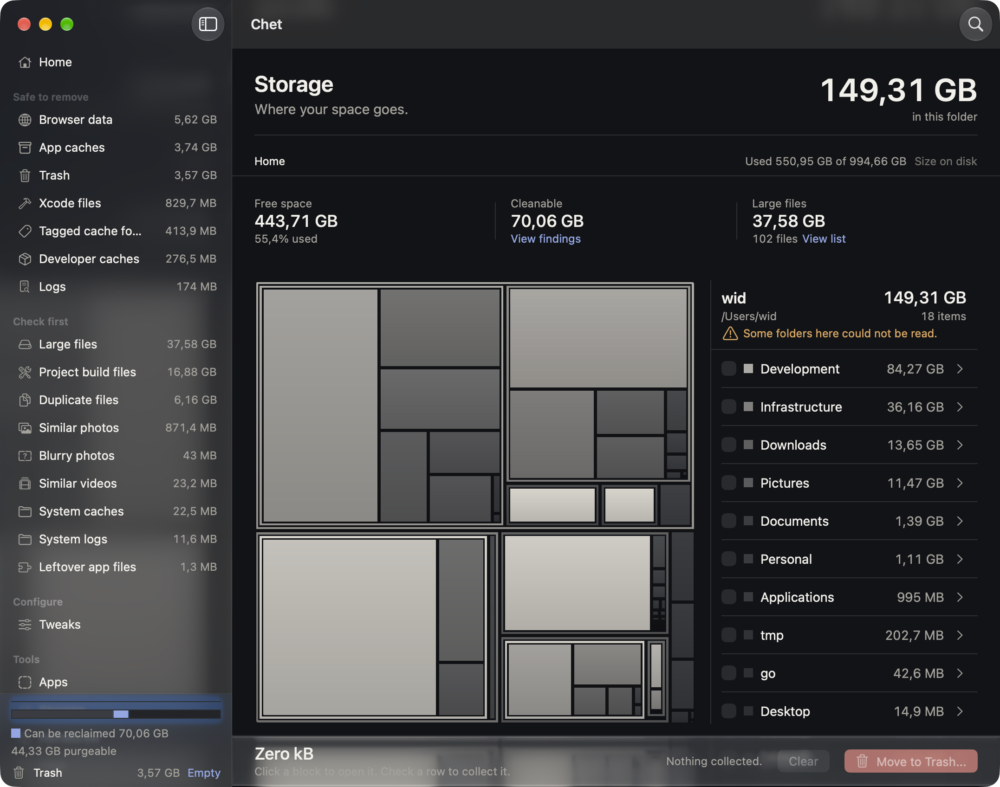
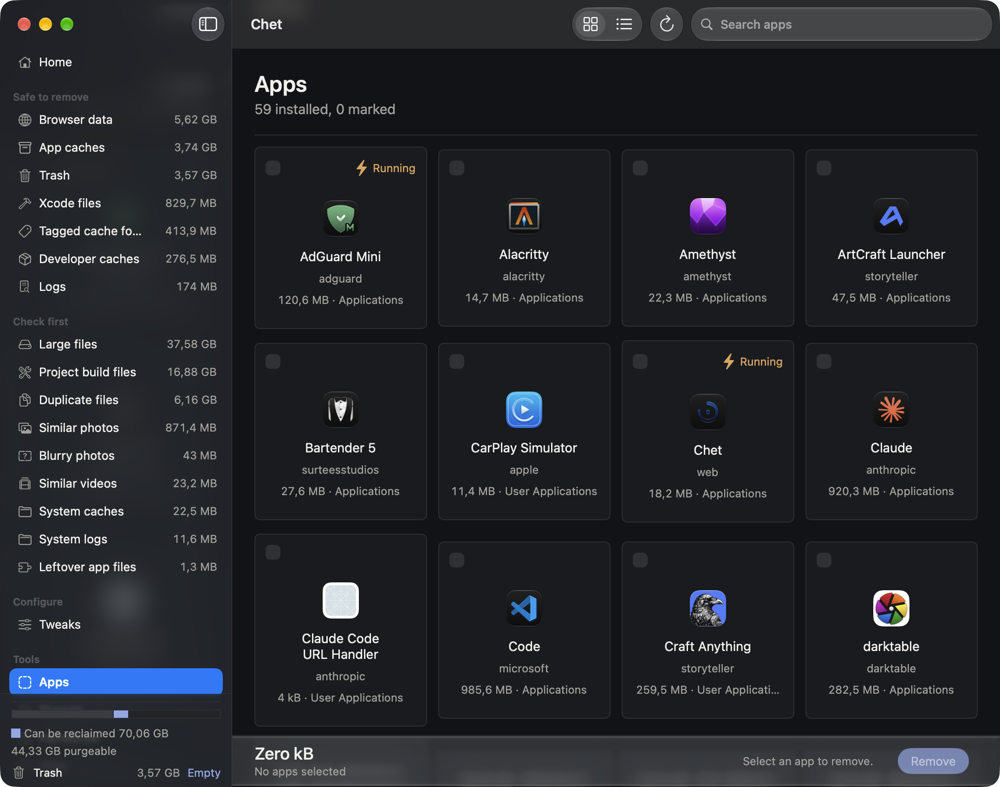
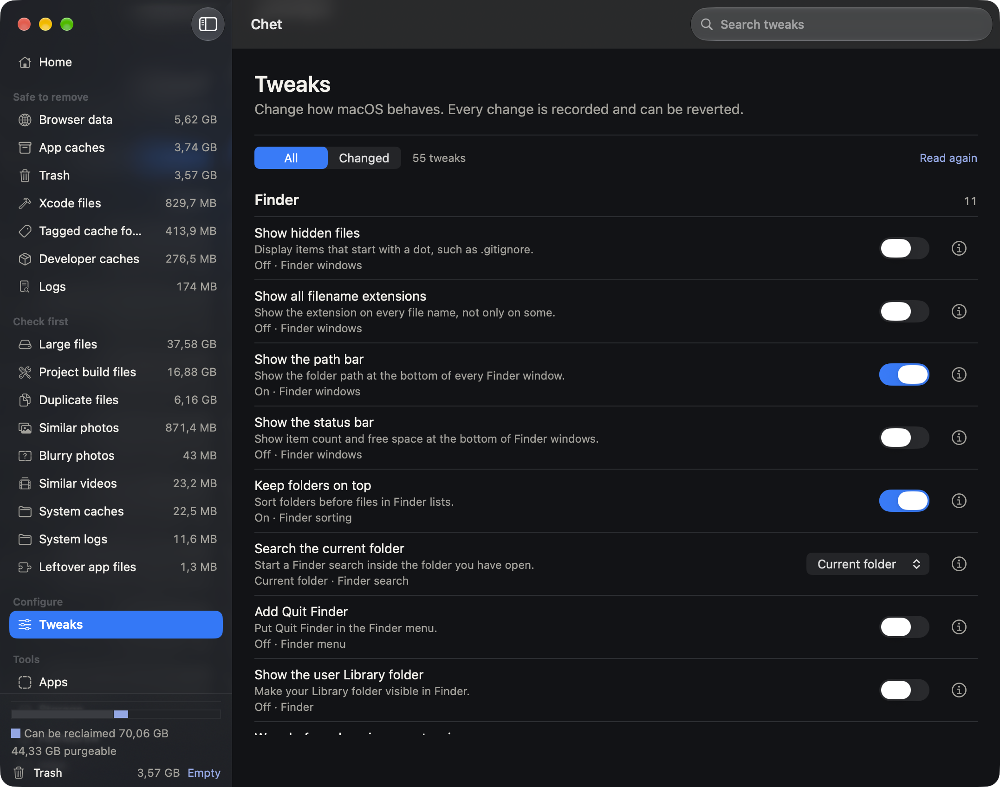
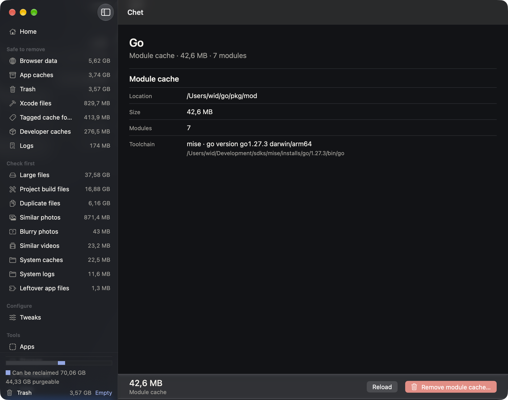
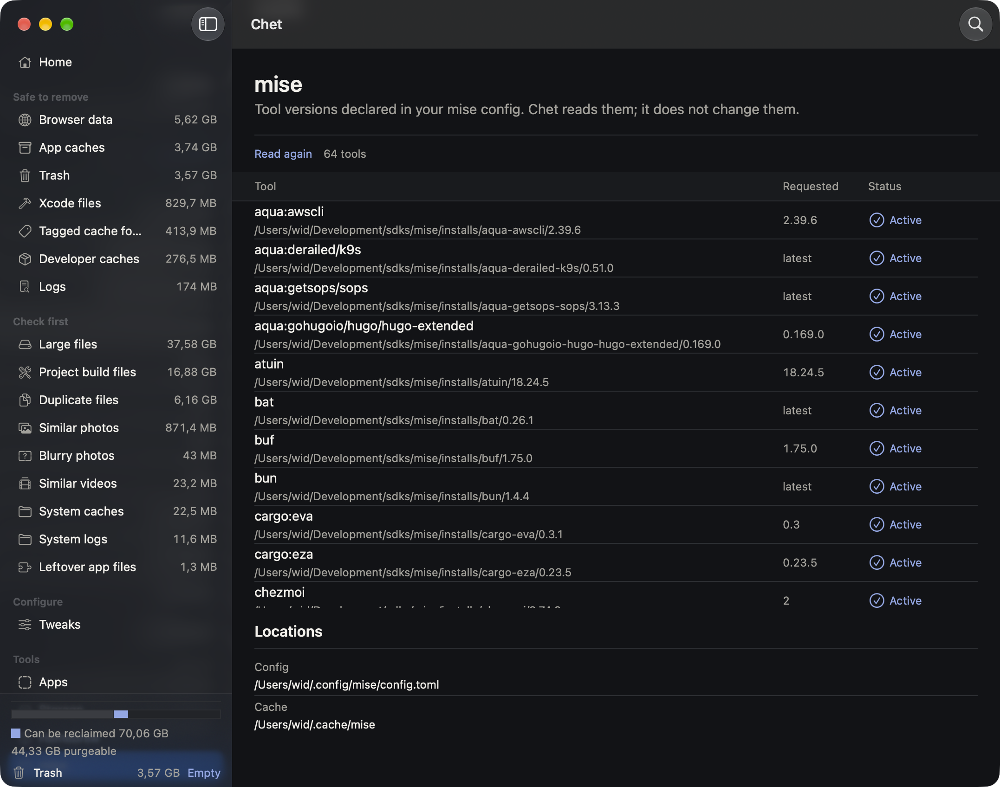

# Chet

Chet finds the space you can get back on your Mac, and shows you every file before it goes.

Disk space leaves in small pieces: build folders from projects you finished, caches from apps
you still run, an installer you opened once, a phone backup from a phone you replaced. Finder
does not show any of it.

Chet scans those places, adds up the space, and puts each finding in one list. You see the
size, why it is there, and what happens when you remove it. Then you decide.

## What it shows

Home starts with a scan and a single number: how much Chet can free. The findings split into
two lists.

**Safe to remove** holds what apps rebuild on their next launch: caches, logs, Xcode build
data, package manager caches, browser data, Mail downloads, and the Trash. These rows are
selected for you.

**Check first** holds what you may still want: old installers, iPhone and iPad backups,
duplicate files, large files, data left by removed apps, similar photos and videos, and Time
Machine snapshots. These rows are never selected for you.

Open a category to see each item, its size, and where it lives. Select what should go, press
Remove, and read the confirmation. The summary tells you what moved, what was skipped, and
how much space came back.

## Install

Chet runs on Apple Silicon Macs with macOS 26 or newer. It ships as a zip; unzip it and move
Chet to Applications.

Chet is not notarized. On another Mac, macOS blocks the first launch: right-click the app and
choose Open.

## First launch

Full Disk Access is optional, and it decides how much Chet can see. Without it, macOS hides
caches, Mail downloads, and browser data, so a scan finds less. The first screen opens the
right System Settings pane; grant access to Chet and scan again.

Press Scan (Command-R). A full scan takes a few minutes on a busy disk. You can pause it, and
you can scan a part of your home folder instead of all of it.

## Nothing leaves on a guess

Chet refuses more than it removes. One check answers the same question for every path: may
this be removed at all? System folders, app bundles, iCloud Drive, Keychains, Mail and
Messages data, Photos libraries, `.git` folders, symlinks, and other volumes are refused.

Before a removal, Chet compares each file with what the scan saw: inode, size, and
modification time. If anything changed, the file stays. Caches of a running app are skipped
and the summary names the app to quit. Duplicates are compared byte for byte and one copy
always stays.

Caches and logs are deleted because apps create them again as they run. Your own files go to
the Trash, where you can put them back. Time Machine snapshots are removed with `tmutil`.

Every item is written to `~/Library/Logs/chet/clean.log`, one line per removal, with its
category, path, size, and result.

## Storage

Storage ranks the folders in your home folder by size and draws them as a map. Open a folder
to look inside. Use it when you want to know what is large before you decide what to remove.

## Apps

Dragging an app to the Trash leaves its preferences, containers, caches, logs, and launch
agents behind. Apps reads the app bundle, then finds Library data that names its bundle
identifier or one of its helpers.

Each row says why it matched. Exact bundle identifier and helper matches are selected. Name
matches stay unchecked. Group containers shared with another app cannot be selected. Related
files move first and the app bundle moves last, so a failed move never hides the app itself.
Everything goes to the Trash.

## Tweaks

Finder, Dock, keyboard, screenshots, windows, and appearance have settings macOS keeps out of
System Settings. Tweaks lists them, shows the current value, labels the risk, and names what
must restart: Finder, the Dock, the menu bar, or the whole session.

Chet writes one value at a time, reads it back to verify, and records the change in
`~/Library/Application Support/Chet/tweaks.log`. The pane counts what you changed and can put
every tweak back to its original value.

## Go and mise

Two pages cover the tools a developer installs. Both read only; neither changes your setup.

**Go** shows the module cache Go keeps for downloaded dependencies: where it is, how large it
is, how many modules it holds, and which toolchain Chet found. Remove module cache runs
`go clean -modcache`; the next build downloads the modules again. The page stays hidden when
Chet cannot find Go.

**mise** lists the tools declared in `~/.config/mise/config.toml`, with the version you asked
for, whether each tool is installed and active, and where it lives. It also shows the config
file and the cache folder. It runs `mise ls` and nothing else, so it cannot install, switch, or
remove a tool. The page stays hidden when the config declares no tools or no mise binary is
found.

## Settings

Settings holds the scan scope, the categories to include, and the administrator panel. Set a
scan to include only the folders you care about, and Chet remembers it for the next run.

## Administrator cleanup

Root-owned caches, logs, and app remnants need an administrator, so Chet includes an optional
helper. It is off until you turn it on and never asks for an administrator by itself.

- Turn it on in Settings, pane Folders, panel Administrator. macOS asks you to approve Chet,
  and you can turn it off in the same panel.
- An approval lasts from 1 to 60 minutes, 10 by default.
- Removal is permanent: root-owned data has no Trash of its own. App bundles are never touched.
- Covered: `/Library/Caches`, `/Library/Logs`, and app remnants under `/Library` such as
  launch agents and daemons. Nothing else outside these trees.

## Limits

Chet does not thin app binaries or remove app languages, because that breaks code signatures.
It does not prune Docker or OrbStack images. It never removes an app bundle that needs
administrator rights. Tweaks changes only the preferences it can read back and verify.

## Keyboard and accessibility

Command-R scans, Command-comma opens Settings, and Escape closes a sheet. Status is always an
icon plus words, never colour alone, and every icon-only button has a spoken label.

## Learn more

The [user guide](docs/USER-GUIDE.md) covers permissions, categories, the scan scope, Tweaks,
Apps, the Go and mise pages, logs, and the administrator helper in detail.
