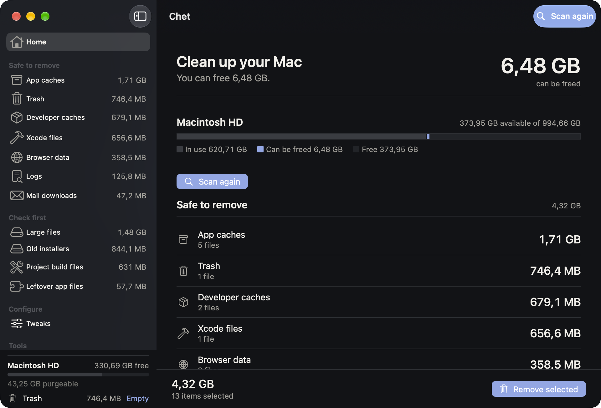

# Chet

Chet is a Mac app that finds the space you can get back and shows you every file before it
goes.

Disk space leaves in small pieces. A build folder from a project you shipped. Caches from apps
you still run. An installer you opened once. A backup of a phone you replaced. None of it
appears when you open Finder and look for free space.

Chet scans those places, adds up the space, and puts each finding in one ledger. You see the
size, the reason it is there, and what happens when you remove it. Then you decide.

## One screen, one number

Home starts with a scan. It counts what Chet can free and splits the result into two lists:

**Safe to remove** holds what apps rebuild on their next launch: caches, logs, Xcode build
data, package manager caches, browser caches, Mail downloads, and the Trash. These rows are
selected for you.

**Check first** holds what you may still want: old installers, iPhone and iPad backups,
duplicate files, large files, data left by removed apps, similar photos and videos, and Time
Machine snapshots. These rows are never selected for you.

Open a category to see each item, its size, and its location. Select what should go, press
Remove selected, and read the confirmation. The summary tells you what moved, what was
skipped, and how much space came back.

## Nothing leaves on a guess

Chet is built around refusal. One safety check answers the same question for every path: may
this be removed at all? System folders, app bundles, iCloud Drive, Keychains, Mail and
Messages data, Photos libraries, `.git` folders, symlinks, and other volumes are refused.

Before a removal, Chet compares each file with what the scan saw: inode, size, modification
time. If anything changed, the file stays. Caches of a running app are skipped, and the
summary names the app to quit. Duplicates are compared byte for byte, and one copy always
stays.

Caches and logs are deleted because apps create them again as they run. Your own files go to
the Trash, where you can put them back. Time Machine snapshots are removed with `tmutil`. Every item is written
to `~/Library/Logs/chet/clean.log`, one JSON line per removal, with its category, path, size,
mode, and result.

## Change the settings macOS hides

Finder, Dock, keyboard, screenshots, windows, and appearance have preferences that normally
need a `defaults write` command or a hidden checkbox. Tweaks lists them, shows the current
value, labels the risk, and names what has to restart: Finder, the Dock, the menu bar, or the
whole session.

Chet writes one value at a time, reads it back to verify, and appends the change to
`~/Library/Application Support/Chet/tweaks.log`. The pane counts what you changed and resets
every tweak to its original value in one action.

## Remove the app and what it left behind

Dragging an app to the Trash leaves its preferences, containers, caches, logs, and launch
agents behind. Apps reads the app bundle, then finds Library data that names its bundle ID or
one of its helpers.

Each row says why it matched. Exact bundle ID and helper matches are selected. Name-only
matches stay unchecked. Group containers shared with another app cannot be selected. Entries
in folders you cannot write are shown read-only. Related files move first and the app bundle
moves last, so a failed move never hides the app itself. Everything goes to the Trash.

## See the shape of your disk

Storage ranks the folders in your home folder by size. Click a folder to look inside. Use it
when you want to know what is large before you decide what to remove.

## Built like a Mac app

Chet is a native SwiftUI app with a light and dark appearance. Status is an icon plus words;
color never carries a state on its own. Icon-only buttons take their name from the shared
button component, so VoiceOver reads a real label. Sheets close with Escape, Scan is Command-R,
Settings is Command-comma, and selection has keyboard shortcuts. The interface has no custom
animation; the only motion is the system progress spinner while a real scan or clean runs.

## Requirements

- A Mac with Apple Silicon (M1 or newer). Chet is built for arm64 only.
- macOS 26 or newer.

## Try it

Chet is not distributed as a signed app. Build it from source with the steps in
[DEVELOPMENT.md](DEVELOPMENT.md), then launch it.

1. Press Scan.
2. Read the two lists. Safe to remove is selected; Check first is not.
3. Open a category, choose the items you want gone, press Remove selected, and confirm.

Full Disk Access is optional. Without it, Chet sees less: macOS hides caches, Mail downloads,
and browser data from apps that do not have it. The permission screen opens the right System
Settings pane. Categories that hit a hidden folder show a lock icon.

## Documentation

- [User guide](docs/USER-GUIDE.md): permissions, categories, limits, Tweaks, Apps, and logs.
- [Development](DEVELOPMENT.md): build tasks, project layout, engines, Metal, and tests.
- [Design](docs/DESIGN.md): the interface direction, tokens, and components.

## Administrator cleanup

Root-owned caches, logs, and app remnants need an administrator, so Chet ships a privileged
helper. It is off until you turn it on, and it never asks for an administrator on its own.

- Turn it on in Settings, pane Folders, panel Administrator. macOS then asks you to approve
  Chet, and you can turn it off in the same panel.
- The helper lives inside the app at `Contents/Library/LaunchDaemons`, starts on your first
  removal, and exits when the approval runs out. An approval lasts from 1 to 60 minutes, 10
  by default.
- Removal is permanent: root-owned data has no Trash of its own. App bundles are never
  touched, and every removal is checked again before it happens.
- Covered: `/Library/Caches`, `/Library/Logs`, and app remnants under `/Library` such as
  launch agents and daemons. Nothing else outside these trees.
- With `DRY_RUN=1` the helper is never registered and never called.

## Limits

Chet does not thin app binaries or remove app languages, because that breaks code signatures.
It does not prune Docker or OrbStack images. It never removes an app bundle that needs
administrator rights. Tweaks changes only the preferences it can read back and verify.

The app is ad-hoc signed and not notarized. On another Mac, macOS blocks the first launch.
See the [user guide](docs/USER-GUIDE.md#install-on-another-mac).
